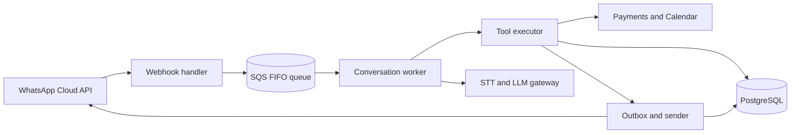

<div align="center">

# Waani

**WhatsApp automation for businesses: flows, bookings, shop-and-pay, and voice, built to never double-send or double-book.**

[](https://github.com/OWNER/REPO/actions/workflows/ci.yml)
[](LICENSE)
[](https://github.com/OWNER/REPO/commits/main)
[](https://github.com/OWNER/REPO/issues)
[](CONTRIBUTING.md)
[](#roadmap)

[](https://www.typescriptlang.org/)
[](https://nodejs.org/)
[](https://nextjs.org/)
[](https://nestjs.com/)
[](https://www.postgresql.org/)
[](https://redis.io/)
[](https://aws.amazon.com/)
[](https://developers.facebook.com/docs/whatsapp/cloud-api)
[](https://openrouter.ai/)

</div>

---

## Why waani

Small businesses sell and support customers on WhatsApp, but the official API means Meta onboarding, template approvals, a 24-hour reply window and cost rules that small teams cannot manage. Generic bots also break on real transactions: duplicate orders from double taps, double-booked slots, and repeated replies after webhook retries.

waani gives a business a customizable flow builder, a shared inbox and reliable tool execution, so it can go live in one session and trust what runs.

## Features

| Area | What you get |
| --- | --- |
| **Flow builder** | Visual graph of triggers, messages, buttons and lists, input collection, conditions, tool calls, AI steps, waits and human hand-off. Published flows are versioned and immutable |
| **Ecommerce flow** | Collections, product details and variants, cart, address and delivery ETA, payment link, order confirmation |
| **Clinic booking** | Services and doctors, free slots, slot holds, Google Calendar sync, reschedule and cancel, 24-hour and 2-hour reminders |
| **Voice notes** | Customer voice messages are transcribed and treated as normal chat; paid and booking steps still need a button tap |
| **Task-limited AI step** | Per-session isolated context, tools limited to what each business enabled, grounded answers, human hand-off when unsure |
| **Shared inbox** | Assignment, notes, delivery status, window timer, template-only composer after the window closes |
| **Templates and consent** | Template manager with cost preview, consent ledger, opted-in broadcasts only |
| **Cost control** | Message ledger, spend dashboard, alerts on projected spend, AI and speech usage caps |
| **Customization** | Per-business tools, data, hours, languages and payment provider, plus a generic webhook tool for custom integrations |

## Reliability by design

The model only proposes a tool call. A deterministic executor validates, deduplicates, runs and records it.

- **One lane per conversation:** messages from one customer are processed in order; many conversations run in parallel.
- **Idempotent tools:** every write uses a deterministic key with claim-then-run and a stored result, so a retry or replay never repeats an effect.
- **Transactional outbox:** each reply is saved with the state change and sent once.
- **Database-enforced correctness:** unique constraints for one booking per slot and one paid state per order.
- **Safe failure:** model fallbacks, bounded tool loops, and a scripted reply plus human hand-off so a chat is never left silent.



## Tech stack

| Layer | Choice |
| --- | --- |
| Language | TypeScript on Node.js, shared Zod schemas |
| Web | Next.js, Tailwind CSS, shadcn/ui, React Flow |
| API and workers | NestJS (Fastify), modular monolith with `api`, `ingest` and `worker` deployables |
| Data | PostgreSQL with row-level security, pgvector, Drizzle ORM |
| Queue and cache | Amazon SQS FIFO, Redis |
| Messaging | WhatsApp Cloud API (Tech Provider, Embedded Signup v4) |
| AI | OpenRouter behind an internal gateway; Whisper and Sarvam for speech |
| Infra | AWS (Mumbai), ECS Fargate, Terraform, GitHub Actions |
| Observability | OpenTelemetry, Sentry, structured logs |

## Getting started

> The commands below are the intended setup. Adjust them to match the repository as it is built.

**Prerequisites:** Node.js (LTS), pnpm, Docker, a Meta developer app with WhatsApp enabled.

```bash
# 1. Clone
git clone https://github.com/OWNER/REPO.git
cd REPO

# 2. Install dependencies
pnpm install

# 3. Start Postgres and Redis locally
docker compose up -d

# 4. Configure environment
cp .env.example .env
# fill in the values from the table below

# 5. Run migrations
pnpm db:migrate

# 6. Start everything
pnpm dev
```

### Environment variables

| Variable | Purpose |
| --- | --- |
| `DATABASE_URL` | PostgreSQL connection string |
| `REDIS_URL` | Redis connection string |
| `META_APP_ID`, `META_APP_SECRET` | Meta app credentials |
| `META_WEBHOOK_VERIFY_TOKEN` | Webhook verification token |
| `TOKEN_ENCRYPTION_KEY` | Key used to encrypt customer WhatsApp tokens |
| `OPENROUTER_API_KEY` | LLM and transcription via OpenRouter |
| `SARVAM_API_KEY` | Optional: Indian-language speech to text |
| `RAZORPAY_KEY_ID`, `RAZORPAY_KEY_SECRET` | Optional: payment links (India) |
| `STRIPE_SECRET_KEY` | Optional: payment links (international) |
| `GOOGLE_CLIENT_ID`, `GOOGLE_CLIENT_SECRET` | Google Calendar sync |

Never commit real secrets. Keep `.env` in `.gitignore`.

## Project structure

```text
.
├── apps/
│   ├── web/        # Next.js dashboard, inbox, flow builder
│   ├── api/        # REST API and real-time gateway
│   ├── ingest/     # Webhook handler (verify, store, ack)
│   └── worker/     # Conversation lanes, tool executor, sender
├── packages/
│   ├── flow-engine/   # Flow graph runtime and validator
│   ├── tools/         # Tool registry and built-in tools
│   ├── llm-gateway/   # OpenRouter client, tiers, fallbacks
│   └── shared/        # Zod schemas and types
├── infra/          # Terraform
└── docs/           # PRD and architecture
```

## Testing

```bash
pnpm test          # unit tests
pnpm test:e2e      # Playwright end-to-end
pnpm test:chaos    # crash, retry and replay tests for the tool executor
```

## Roadmap

- [ ] **Core:** onboarding, webhook ingestion, queue, outbox, idempotent tool executor, inbox, templates
- [ ] **Flow builder and clinic booking:** nodes, simulator, slot holds, reminders, Calendar sync
- [ ] **Voice and AI step:** speech pipeline, tool allow-lists, caps, FAQ agent
- [ ] **Ecommerce:** catalog import, cart, delivery ETA, payment links
- [ ] **Billing and hardening:** subscriptions, spend dashboard, ops console, alerts

## Contributing

Issues and pull requests are welcome. Please open an issue first for larger changes, keep tests passing, and follow the existing code style.

## Security

Please report vulnerabilities privately by email to the maintainers instead of opening a public issue.

## License

Released under the [MIT License](LICENSE). Replace this section if you choose a different license.

---

<div align="center">

Built for businesses that live on WhatsApp.

</div>
